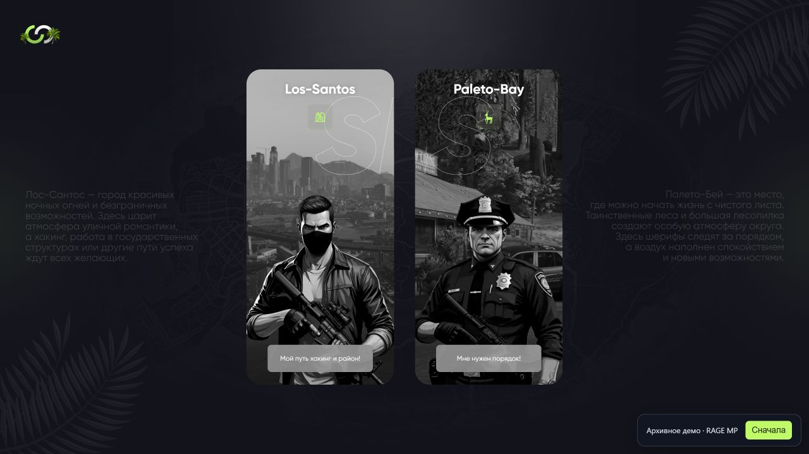

# RAGE MP · Выбор спавна



Архивная работа для **RAGE MP**. Интерфейс опубликован для знакомства с моими ранними проектами.

[Открыть демо](https://xtrasupra.github.io/ragemp-spawn-selection-ui/) · [Исходный код](https://github.com/xtrasupra/ragemp-spawn-selection-ui)

## О проекте

Это моя ранняя работа для RAGE MP, сохранённая как часть истории развития навыков разработки игровых интерфейсов. В оформлении и сценариях взаимодействия отражён подход, с которым я работал на этом этапе.

## Возможности

- Два визуальных направления: Los Santos и Paleto Bay.
- Авторские композиции из растровых иллюстраций и SVG.
- Анимированные состояния наведения и световые акценты.

## Запуск

Требуется Node.js 22.12+ или 24+.

```bash
npm ci
npm run dev
```

`npm run build` создаёт готовый сайт в `docs/`. GitHub Pages публикует эту папку из ветки `main`. Пути ресурсов относительные, поэтому демо работает и в подпапке репозитория.

## Демонстрационный режим

Сайт позволяет познакомиться с внешним видом и локальными состояниями интерфейса. Игровые действия требуют клиента и сервера RAGE MP. Браузерная обвязка показывает уведомление о выборе действия; она не подключается к серверу, не сохраняет и не отправляет введённые данные. Кнопка «Сначала» возвращает экран в исходное состояние.

## Подготовка архива

Для самостоятельного запуска добавлены точка входа, Vite и браузерная обвязка. Служебные файлы и дубли архивов исключены; исходная визуальная концепция сохранена. Недостающий ресурс `SLS.png` восстановлен из исходного архива проекта. Крупные иллюстрации переведены в WebP для ускорения загрузки. Текущая версия представляет визуальный прототип: выбор точки в игровом мире в неё не входит.

## Автор

Бехтеев Д. Н. ([xtrasupra](https://github.com/xtrasupra)). Работа опубликована как часть личного портфолио. Исходные указания об авторстве и источниках сохраняют силу; игровые обозначения, графика и шрифты принадлежат соответствующим правообладателям.
